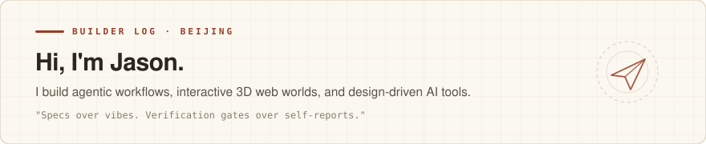

<picture>
  <source media="(prefers-color-scheme: dark)" srcset="./banner-dark.svg">
  <source media="(prefers-color-scheme: light)" srcset="./banner-light.svg">
  
</picture>

 

<table>
<tr>
<td width="50%" valign="top">

#### 🧭 Focus Areas

- **Agentic Engineering & Harness**  
  Multi-agent orchestration, contract-pinning gates, and deterministic verification loops that keep AI-written codebases from regressing.
- **Interactive 3D & Design Engineering**  
  Procedural Three.js miniature worlds, real-time WebGL PBR shaders, and high-craft web interfaces that don't look like default AI templates.
- **AI-Native Knowledge & Media Systems**  
  End-to-end pipelines turning raw knowledge into interactive micro-courses, bilingual voiceovers, and structured second brains.

</td>
<td width="50%" valign="top">

#### 🛠 Core Stack & Workflow

- **Languages & Runtime**  
  `TypeScript` · `Python` · `Node.js` · `SQL`
- **Frontend & Graphics**  
  `Three.js / WebGL` · `React / Next.js` · `Vite` · `Remotion`
- **AI & Agent Infrastructure**  
  `Claude Code` · `Codex` · `Playwright` · `Custom Skills & Harnesses`
- **Engineering Discipline**  
  Spec-first architecture (`MASTER-SPEC`) · Automated visual & behavioral gates (`verify.sh`)

</td>
</tr>
</table>
